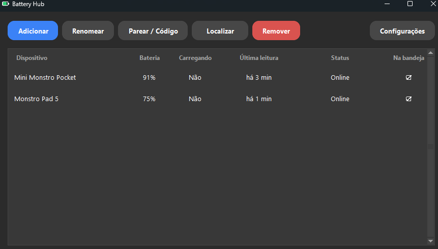
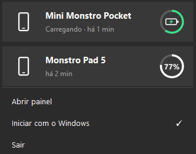
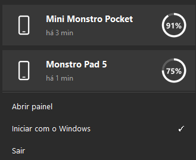
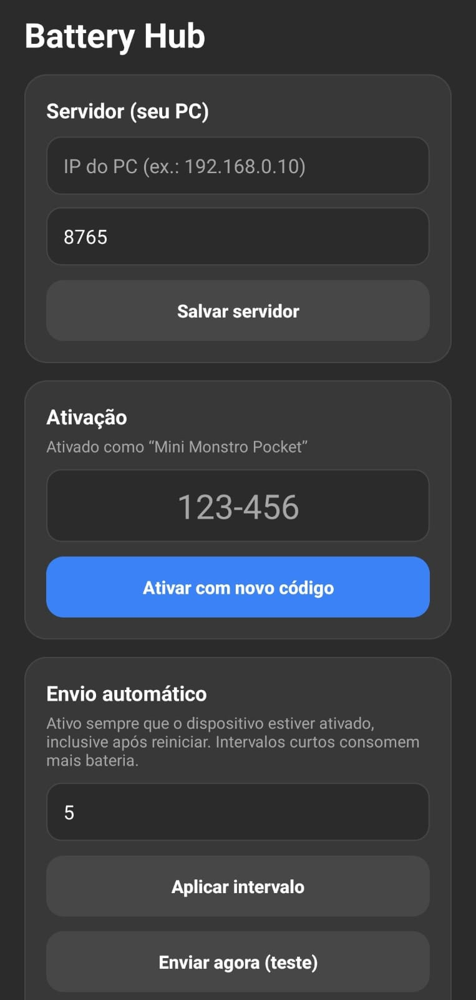
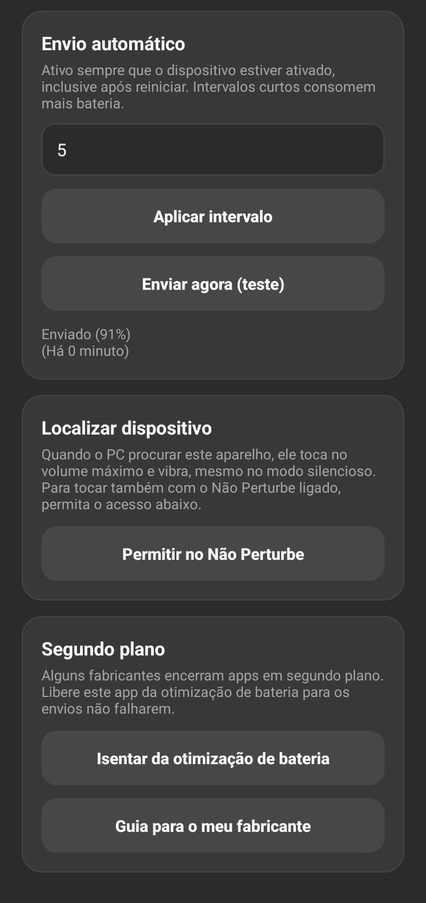

# Battery Hub


Acompanhe a bateria dos seus **celulares e tablets Android** direto na **bandeja do Windows**, pela rede local.
Sem nuvem, sem conta, sem Firebase e sem custo: os aparelhos falam direto com o seu PC.

Quando um aparelho some dentro de casa, um clique no PC faz ele **tocar e vibrar** até você encontrá-lo.

## Capturas de tela

### PC

<p align="center">
  
</p>

<p align="center">
  
  &nbsp;&nbsp;&nbsp;
  
</p>

### Android

<p align="center">
  
  &nbsp;&nbsp;&nbsp;&nbsp;
  
</p>

## Recursos

**No PC**
- Ícone na bandeja com popup próprio (tema claro ou escuro do Windows): um cartão com anel de progresso para cada aparelho.
  Carregando, o anel mostra uma bateria com raio no lugar da porcentagem.
- Painel para cadastrar, renomear, remover e escolher quais aparelhos aparecem na bandeja.
- **Pareamento por código** de 6 números (`123-456`), como o de apps de TV: nada de digitar token.
- **Localizar dispositivo:** o aparelho toca no volume máximo e vibra, com indicador na lista, no popup e no ícone da bandeja.
- Avisos do Windows: bateria baixa, aparelho sem reportar e bateria em 100%.
- Instalador com o mesmo visual do app, escolha da pasta, atalhos e início com o Windows.

**No Android**
- Envio automático da bateria em intervalo configurável (padrão **5 min**, de 1 a 1440), sempre ativo depois da ativação.
- Sobe sozinho depois de reiniciar o aparelho ou atualizar o app.
- Toca e vibra ao ser localizado, mesmo no silencioso, e pode furar o Não Perturbe (com permissão).
- Leve: sem bibliotecas externas, só o framework do Android.

## Como funciona

```
 Android                                             PC (Windows)
 ┌──────────────────────┐   POST /battery (a cada N min)   ┌───────────────────────────┐
 │ serviço em 1º plano  │ ───────────────────────────────▶ │ servidor HTTP  ──▶ SQLite │
 │                      │                                  │      │                    │
 │ canal GET /events    │ ◀─ "find-start" / "find-stop" ── │      ▼                    │
 │ (conexão parada)     │ ── POST /find/ack ─────────────▶ │ bandeja, painel e alertas │
 └──────────────────────┘                                  └───────────────────────────┘
```

O PC e os aparelhos precisam estar na **mesma rede**. Cada aparelho tem um token próprio, entregue no pareamento.

## Instalação

Baixe os arquivos na página de [**Releases**](https://github.com/Teus42/BatteryHub/releases/latest).

### 1. PC

1. Execute `BatteryHub-Setup-<versão>.exe` e siga o assistente. Por padrão ele instala em
   `%LOCALAPPDATA%\Programs\Battery Hub`, sem exigir administrador, e você pode escolher outra pasta.
2. Deixe marcada a opção de liberar a porta **8765** no Firewall (pede permissão de administrador). Sem isso os
   aparelhos não alcançam o PC. Dá para fazer depois em *Configurações → Liberar porta no Firewall*.
3. **Reserve um IP fixo** para o PC no roteador. Se o IP mudar, os apps deixam de achar o servidor.

> O instalador não tem assinatura digital, então o Windows SmartScreen pode avisar "editor desconhecido" na
> primeira execução (*Mais informações → Executar assim mesmo*).

### 2. Android

1. Copie `BatteryHub-<versão>.apk` para o aparelho e abra. O Android vai pedir para permitir a instalação de fontes
   desconhecidas.
2. Se você já instalou uma versão de depuração (compilada por você), desinstale antes: a assinatura é diferente.

### 3. Parear

1. No PC, abra o painel e clique em **Adicionar**. Dê um nome ao aparelho: aparece um código `123-456`, válido por 10 min.
2. No app Android, informe o **IP do PC** e a porta, digite o código e toque em **Ativar dispositivo**.
3. O PC mostra **Conectado com sucesso!** e o aparelho começa a enviar a bateria.

## Uso

| Quero… | Como |
|---|---|
| Ver a bateria | Clique direito no ícone da bandeja (aparecem os aparelhos marcados em **Na bandeja**) |
| Escolher o que aparece na bandeja | No painel, clique na célula **Na bandeja** do aparelho |
| Localizar um aparelho | Painel: selecione e clique em **Localizar**. Bandeja: clique no cartão do aparelho. Clique de novo para parar |
| Refazer o pareamento | Painel: **Parear / Código** gera um novo código (o token antigo deixa de valer) |
| Ajustar alertas | Painel: **Configurações** (porta, tempo para considerar offline, limite de bateria baixa) |

**Localizar dispositivo:** o status passa de *Procurando…* (pedido enviado) para *Tocando no aparelho* (o aparelho
confirmou). O ícone da bandeja ganha uma bolinha vermelha enquanto houver busca. O pedido vale por 10 min e o aparelho
para sozinho nesse prazo. Se ele estiver fora do ar, toca quando reconectar. No aparelho, o botão **Parar** da
notificação ou **Parar toque** no app silencia na hora.

## Detalhes e limitações do Android

- **Alarmes exatos.** O ritmo de envio vem do `AlarmManager`, não de um timer interno, que atrasaria com a CPU em repouso.
  Cada ciclo lê a bateria, envia e agenda o próximo. Se o PC estiver desligado, o ciclo falha e espera o seguinte.
- **Canal com o PC.** Uma única conexão parada (`GET /events`) por onde o PC manda o comando de localizar. Sem comando ela
  quase não gasta bateria (só um sinal a cada 4 min) e reconecta sozinha se o PC ou o Wi-Fi caírem.
- **Modo silencioso e Não Perturbe.** O som usa o canal de alarme, que o silencioso não cala, e o app sobe o volume do
  alarme ao máximo (restaurando-o depois). O Não Perturbe pode calar o alarme: use **Permitir no Não Perturbe** no app e o
  bloqueio é suspenso só enquanto toca.
- **Fabricantes agressivos** (Xiaomi, Samsung, Huawei…) encerram apps em segundo plano. Use **Isentar da otimização de
  bateria** e **Guia para o meu fabricante**. Em Xiaomi, ligue também *Iniciar automaticamente* nas configurações do app.
- **Doze.** Com a tela apagada por muito tempo e fora do carregador, o Android pode bloquear a rede e atrasar envios e o
  comando de localizar. Isentar o app da otimização de bateria resolve na maior parte dos casos.
- **Depois de reiniciar** o aparelho, o envio volta após o primeiro desbloqueio (regra do Android).
- Intervalos curtos consomem mais bateria.

## Segurança e privacidade

- Tudo fica na sua rede e no seu PC. Não há nuvem nem telemetria.
- Cada aparelho usa um **token próprio** (`Authorization: Bearer`). Remover o aparelho ou refazer o pareamento invalida o antigo.
- O código de pareamento vale 10 min, é de uso único e o servidor limita tentativas erradas (5 por minuto por IP e 30 em
  10 min no total).
- O tráfego é **HTTP sem criptografia**, adequado a uma rede local de confiança. Não exponha a porta na internet.
- Os dados ficam em `%APPDATA%\BatteryHub\hub.db` (histórico de 30 dias), incluindo os tokens, sem criptografia.
  Atualizar ou desinstalar o app **não** apaga esse arquivo, a menos que você peça.

## API

Todas as rotas `POST` e `GET /events` usam `Authorization: Bearer <token-do-dispositivo>`, exceto `/pair` e `/health`.

```http
POST /pair                      # sem autenticação; só com código válido
{"code": "123456"}              → 200 {"ok": true, "token": "...", "name": "Tablet"}
                                  404 código inválido/expirado · 429 muitas tentativas

POST /battery
{"level": 78, "charging": false, "temperature": 31.2, "voltage": 4.01}   # temperature/voltage opcionais
                                → 200 {"ok": true, "server_time": 1760000000}
                                  401 token inválido · 400 corpo inválido

GET  /events                    # canal aberto pelo aparelho (text/event-stream)
                                # PC escreve "data: find-start" / "data: find-stop";
                                # ": keepalive" a cada 4 min; pedido pendente é entregue ao conectar

POST /find/ack
{"ringing": true}               # o aparelho confirma que começou (true) ou parou (false) de tocar

GET  /health                    → {"ok": true}
```

## Compilar a partir do código

Requisitos: Windows, Python 3.10+, JDK 17 e Android SDK (para o APK).

```powershell
# Rodar o app do PC direto do código
cd pc
pip install -r requirements.txt
pythonw run.py          # ou: python run.py, para ver erros no console

# Gerar instalador + APK (saída em .\build)
.\build_all.ps1
```

`build_all.ps1` usa `JAVA_HOME` e `ANDROID_HOME` (ou `%USERPROFILE%\dev-tools\jdk17` e `\android-sdk`) e gera
`BatteryHub-Setup-<versão>.exe`, `BatteryHub-<versão>.apk` e `SHA256SUMS.txt`.

**Assinatura do APK.** O release é assinado com uma chave sua, lida de `android\keystore.properties` (não versionado):

```powershell
keytool -genkeypair -keystore android\battery-hub.keystore -alias batteryhub -keyalg RSA -keysize 2048 -validity 10000
```

```properties
# android/keystore.properties
storeFile=battery-hub.keystore
storePassword=...
keyAlias=batteryhub
keyPassword=...
```

> Guarde uma cópia do `.keystore` e do `keystore.properties`. Sem a mesma chave, o Android não aceita atualizar o app por cima.

Sem o `keystore.properties`, o Gradle gera `app-release-unsigned.apk`, que o Android não instala. O `build_all.ps1` espera o APK assinado.

## Estrutura do projeto

```
pc/battery_hub/    app do Windows: servidor, banco, bandeja, painel e tema
installer/         instalador e desinstalador (mesmo tema do app)
android/           app Android em Kotlin
tools/, assets/    gerador do ícone e o ícone
docs/screenshots/  imagens deste README
build_all.ps1      gera o instalador e o APK
```

## Ideias futuras

- Botão "pedir a bateria agora" (o canal `/events` já permite).
- Acender a tela e mostrar o botão de parar por cima da tela de bloqueio ao localizar.
- Gráfico do histórico de bateria.
- Descoberta automática do PC na rede (mDNS), sem digitar o IP.

## Licença

Ainda não definida.
